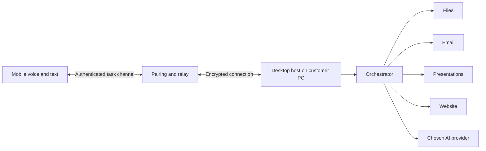

# Architecture sketch

The desktop host owns local file permissions, task state, and provider connections. The phone submits requests and shows progress. Pair each phone explicitly and allow revocation. When the PC is offline, tasks that need its files wait.

The orchestrator breaks a request into steps and gives each specialist only the access needed for its step. The files agent searches customer-approved folders. The email agent drafts and sends through an authorized mail connection. The presentation agent creates and revises slides. The website agent prepares fixes in a reviewable workspace and shows a preview or diff before deployment.

For a request from the car to email a PC file: transcribe the request, find candidate files, resolve ambiguity, prepare the draft, confirm the recipient and exact attachment by voice or on screen, then send and return a receipt. Sending email or files, publishing a live website, and spending money require explicit customer approval. Keep credentials in local secure storage and an audit record of approvals without recording sensitive file contents by default.

Build order: desktop host and task state; orchestrator; mobile pairing and task channel; files and email draft flow; voice input; presentations and website specialists. Add official ChatGPT sign-in and optional provider adapters behind a shared model interface.

## Website agent: two site types

For a simple Next.js marketing site, keep editable copy and image references in repository files. The website agent proposes a small Git change, checks the build, and gives the customer a Vercel preview. After approval, publish through the site's normal Git deployment. This avoids a separate content database or CMS for the site; the agent service still needs identity, permissions, task state, and an approval channel.

For a site with a database, make content changes through the application's authorized API or admin workflow. Do not let the model execute arbitrary database queries or bypass validation. Keep code changes in Git with previews, and treat live data changes as separate operations with their own confirmation and audit record.

Each customer must see only their own repositories, projects, domains, and drafts. Start with narrow edits such as text, hours, prices, and approved images. Route layout, features, migrations, and checkout changes to an expert review flow. A voice request may start the work, but the customer should inspect a visual preview before a design change goes live.
